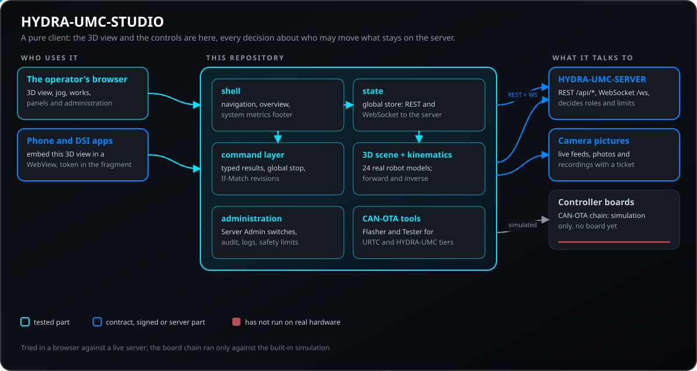
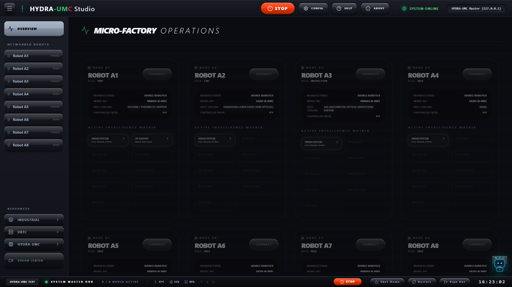
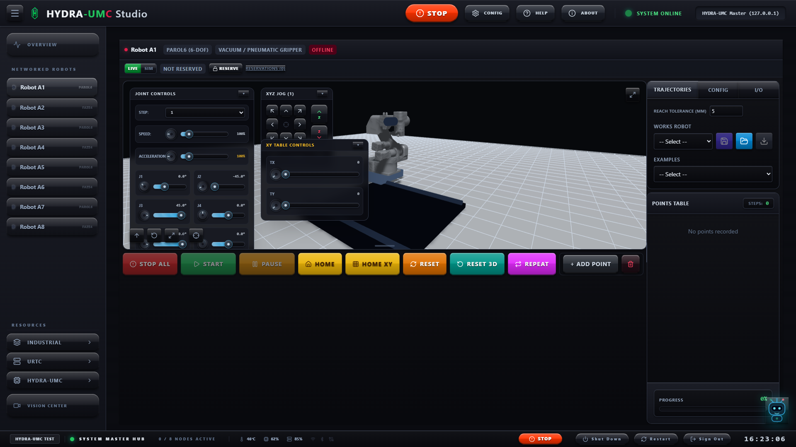
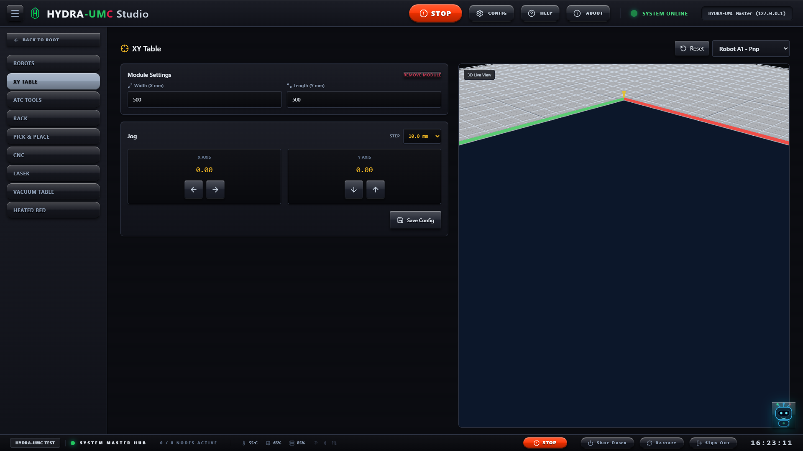
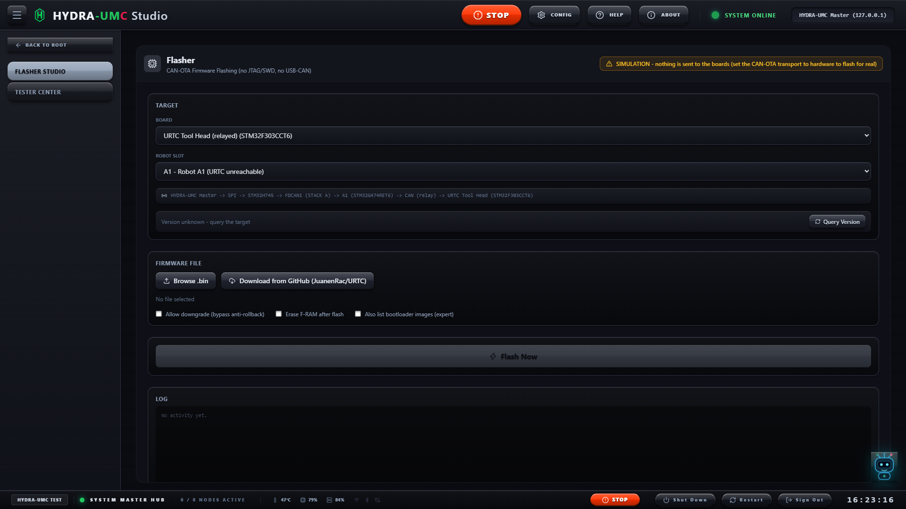
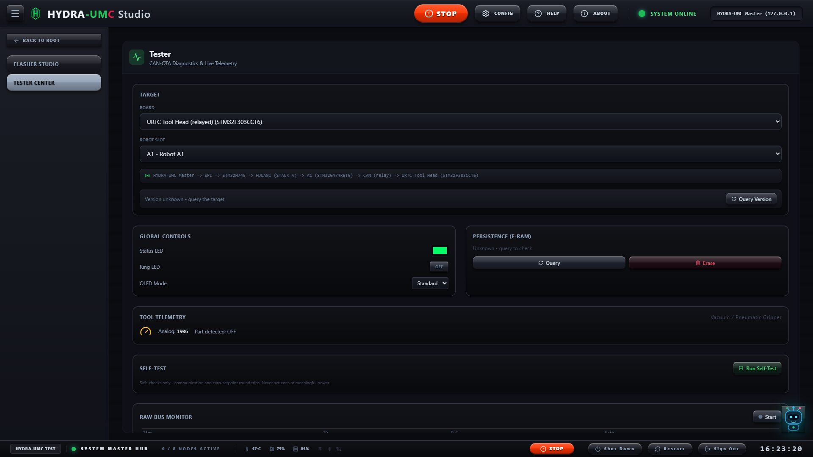
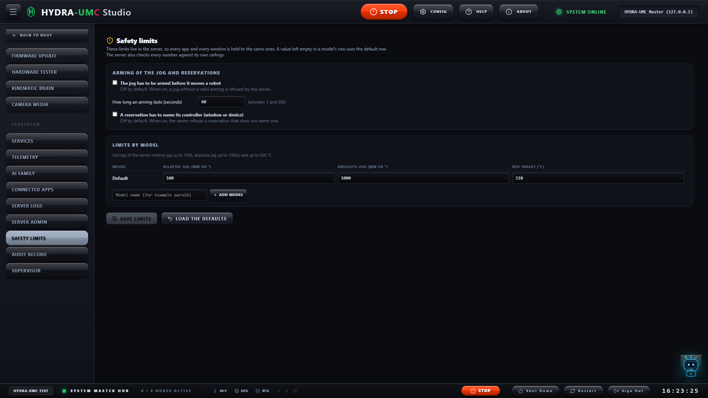
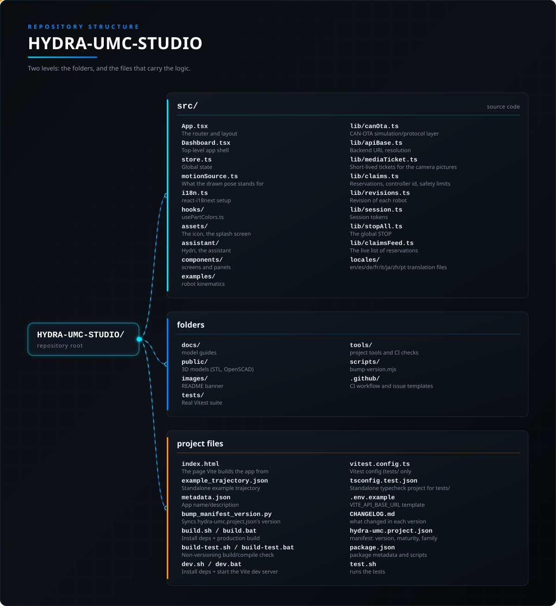

<!-- =============================================================================
HYDRA-UMC-STUDIO - Web control dashboard of the HYDRA-UMC multi-robot micro-factory
Copyright (C) JuanenRac (Electro Hobby 3D) <electrohobby3d@gmail.com>
GPL-3.0-or-later - see LICENSE
============================================================================= -->

<p align="center">
  
</p>

# 🤖 HYDRA-UMC-STUDIO

<p align="center"><a href="README.md">🇺🇸 English</a> | <a href="README_spa.md">🇪🇸 Español</a> | <a href="README_fra.md">🇫🇷 Français</a> | 🇮🇹 <b>Italiano</b> | <a href="README_deu.md">🇩🇪 Deutsch</a> | <a href="README_zho.md">🇨🇳 简体中文</a> | <a href="README_jpn.md">🇯🇵 日本語</a> | <a href="README_por.md">🇵🇹 Português</a></p>

### 🤖 Dashboard di Controllo Web per la Micro-Fabbrica Multi-Robot HYDRA-UMC

<p align="center">
  
  
  
  
  
  
  
  
</p>

---

> **Stato di sicurezza (safety e security):** questo ecosistema non è un sistema di sicurezza certificato. Non esiste ancora un percorso E-STOP hardware, né limiti o interblocchi imposti dal firmware, né un comando di movimento verificato; le immagini firmware sono controllate con CRC-32 e una firma Ed25519, e una compilazione di rilascio rifiuta le chiavi di sviluppo pubblicate (le teste utensile e le schede di espansione dietro il relè usano ancora i bootloader di URTC, che accettano un HMAC-SHA256 a chiave condivisa invece di una firma); TLS e TLS reciproco sono opzionali e disattivati per impostazione predefinita; nessuna scheda propria è stata ancora assemblata o provata. Leggi la [base di sicurezza](https://github.com/JuanenRac/HYDRA-UMC-DOCS/blob/main/docs/SECURITY_BASELINE.md) e il [modello delle minacce](https://github.com/JuanenRac/HYDRA-UMC-DOCS/blob/main/docs/THREAT_MODEL.md) prima di fidarti di qualsiasi affermazione qui per la sicurezza di una persona.

---

## 📋 In breve

| | |
|---|---|
| Versione | `0.8.0.3` |
| Maturità | Funzionale |
| Test | 664 (`npm test`) |
| Tecnologia | React 19 / Vite / Three.js / Tailwind CSS |
| Destinazione | Il Raspberry Pi CM5 di una cella HYDRA-UMC |
| Su hardware reale | Eseguito su un banco di prova: la verifica di onestà qui sopra indica quali parti hanno girato su hardware reale |

**Vai a:** [Panoramica](#-panoramica) · [Architettura](#-architettura) · [Funzionalità](#-funzionalità) · [Sicurezza e protezione](#-sicurezza-e-protezione) · [Interfacce](#-interfacce) · [Configurazione](#-configurazione) · [Avvio rapido](#-avvio-rapido) · [Test](#-test) · [Risoluzione dei problemi](#-risoluzione-dei-problemi) · [Struttura del repository](#-struttura-del-repository) · [Progetti correlati](#-progetti-correlati)

## 🚦 Stato del progetto

Ogni riga è una parte di questo repository e il semaforo dice a che punto è oggi. È scritta in base a ciò che il repository può mostrare (test, compilazioni, esecuzioni), non a ciò che è previsto.

🟢 Fatto e verificato · 🟡 Funziona, con limiti noti · 🟠 Fatto a metà o non ancora verificato · 🔴 Non fatto o non funzionante

| Area | Stato | Cosa significa qui |
|---|---|---|
| Software | 🟡 | Funziona per il suo scopo principale; la verifica di onestà qui sopra elenca ciò che manca ancora |
| Test | 🟢 | 664 test automatici, eseguiti a ogni modifica |
| Hardware reale | 🟡 | Eseguito su un banco di prova: la verifica di onestà qui sopra indica quali parti hanno girato su hardware reale |
| Documentazione | 🟢 | README in otto lingue, verificato rispetto al manifesto a ogni modifica |

## 🎯 Panoramica

**HYDRA-UMC STUDIO** è il dashboard di controllo basato su browser per [HYDRA-UMC](https://github.com/JuanenRac/HYDRA-UMC) - la scheda madre della micro-fabbrica multi-robot (host Raspberry Pi CM5 + coprocessore real-time STM32H745 dual-core) che orchestra fino a 8 bracci robotici distribuiti su un unico bus FDCAN. Mentre il repository di HYDRA-UMC copre l'hardware e il firmware, questo repository è il lato rivolto all'utente umano: un'applicazione React a pagina singola che visualizza ogni robot in 3D reale, esegue jog e registra il loro movimento, gestisce le macchine e gli accessori che accompagnano una cella robotica, e flasha/testa l'intera catena di firmware CAN-OTA - tutto da un'unica scheda del browser, senza bisogno di installazione nativa oltre a Node.js.

**Nota di onestà, seguendo la stessa convenzione di documentazione del resto di questo ecosistema:** l'hardware reale di HYDRA-UMC non esiste ancora come silicio testato (i suoi bootloader compilano senza errori ma non sono mai stati eseguiti su schede reali - vedi il `docs/architecture.md` di quel repository). Per questo motivo questo dashboard esegue i propri strumenti Flasher/Tester CAN-OTA contro una simulazione integrata completa che segue lo schema di indirizzamento reale e documentato di ogni livello, invece di fingere di parlare con un hardware che non esiste. La visualizzazione 3D dei robot, la cinematica, la registrazione delle traiettorie, e ogni pannello di controllo degli accessori sono completamente reali e indipendenti da questo - solo il trasporto CAN-OTA in sé è simulato per ora.

Costruito con **React 19**, **Vite**, **Three.js** (via `@react-three/fiber`/`@react-three/drei`), e **TypeScript** - un client puro senza codice di backend proprio. Lo stato persistente vive nel backend separato **[HYDRA-UMC SERVER](https://github.com/JuanenRac/HYDRA-UMC-SERVER)** con cui questa app comunica in rete.

## 🧩 Ruolo in HYDRA-UMC

**HYDRA-UMC-STUDIO** è il pannello web di controllo della cella: disegna ogni robot in 3D con la sua cinematica reale, muove e registra traiettorie, gestisce i pannelli di accessori e macchine, flasha e collauda il firmware lungo la catena CAN-OTA e amministra il server, in otto lingue. Non conserva stato proprio e non decide nulla sulla sicurezza: ruoli, limiti, prenotazioni e arresto li decide HYDRA-UMC-SERVER.

## 🏛️ Architettura

<p align="center">
  
</p>

## 🖼️ Schermate

Catturate a 1920×1080 su un banco di prova, con dati di esempio e senza alcuna installazione reale dietro.

<table>
<tr><td width="50%" valign="top"><br><sub>Panoramica: gli otto nodi robot della microfabbrica con ruolo, modello e utensile, e lo stato della macchina nella barra in basso.</sub></td><td width="50%" valign="top"><br><sub>Vista robot: comandi dei giunti, jog XYZ, il modello 3D del braccio e il pannello delle traiettorie con i punti registrati.</sub></td></tr>
<tr><td width="50%" valign="top"><br><sub>Tavola XY: le dimensioni della tavola, i pulsanti di jog con il loro passo e la vista 3D dal vivo degli assi.</sub></td><td width="50%" valign="top"><br><sub>Flasher Studio: scegli la scheda e lo slot del robot, un file di firmware e flashalo via CAN; qui in simulazione, quindi non viene inviato nulla a nessuna scheda.</sub></td></tr>
<tr><td width="50%" valign="top"><br><sub>Tester Center: il LED di stato, il controllo di persistenza, la telemetria dell'utensile, l'autotest e il monitor del bus grezzo di una scheda.</sub></td><td width="50%" valign="top"><br><sub>Limiti di sicurezza: armamento del jog, regola delle prenotazioni e i massimi di jog e di temperatura del piano per modello di robot, conservati nel server.</sub></td></tr>
</table>

## ✨ Funzionalità

### Controllo 3D Multi-Robot

Gestisci più robot indipendenti a 6 gradi di libertà (6-DOF) simultaneamente, ciascuno con il proprio modello 3D reale, cinematica, e stato di jog/traiettoria. Il selettore di modello (RobotDetail → scheda Config) raggruppa ogni robot disponibile per produttore:

- 🏭 **Source Robotics** - Parol6, Faze4 (mesh con licenza MIT e GPL-3.0 rispettivamente, vedi il proprio `ATTRIBUTION.txt` di ciascun modello)
- 🏭 **Annin Robotics** - AR3, AR4 (mesh con licenza MIT)
- 🏭 **Universal Robots** - UR3e, UR5e, UR10e, UR16e, UR20 - geometria ufficiale, limiti di giunto, e cinematica dei link estratti direttamente dal repository [Universal_Robots_ROS2_Description](https://github.com/UniversalRobots/Universal_Robots_ROS2_Description) di Universal Robots (BSD-3-Clause), che copre l'intera gamma di carico utile da leggero a pesante della loro linea e-Series
- 🏭 **Universal Robots (classica)** - UR3, UR5, UR10 - la linea CB precedente alla e-Series, geometria/parametri DH ufficiali dal repository [universal_robot](https://github.com/ros-industrial/universal_robot) di ROS-Industrial (BSD-3-Clause)
- 🏭 **UFACTORY** - xArm6, Lite 6 (mesh BSD-3-Clause, geometria/cinematica ufficiale di [xarm_ros2](https://github.com/xArm-Developer/xarm_ros2))
- 🏭 **Comau** - e.DO (mesh BSD-3-Clause, geometria/cinematica ufficiale di [eDO_description](https://github.com/ianathompson/eDO_description))
- 🏭 **Kinova** - Gen3 Lite, Gen2 (mesh BSD-3-Clause, geometria/cinematica ufficiale di [ros2_kortex](https://github.com/Kinovarobotics/ros2_kortex))
- 🏭 **FANUC** - M-710iC (mesh BSD-3-Clause, geometria/cinematica ufficiale di [fanuc_m710ic_description](https://github.com/robot-descriptions/fanuc_m710ic_description))
- 🏭 **The Robot Studio** - SO-ARM100, un braccio economico a 5-DOF (non 6) (mesh Apache-2.0, geometria/cinematica ufficiale di [SO-ARM100](https://github.com/TheRobotStudio/SO-ARM100))
- 🏭 **AgileX** - PiPER (mesh Apache-2.0, geometria/cinematica ufficiale di [agilex_piper_arm_description](https://github.com/renesas-rdk/agilex_piper_arm_description))
- 🏭 **Unitree** - Z1 (mesh BSD-3-Clause, tramite [mujoco_menagerie](https://github.com/google-deepmind/mujoco_menagerie) di Google DeepMind - ogni cartella robot lì mantiene la propria licenza originale del produttore)
- 🏭 **Trossen Robotics** - ViperX 300, WidowX 250 (mesh BSD-3-Clause, geometria/cinematica ufficiale di [interbotix_ros_manipulators](https://github.com/Interbotix/interbotix_ros_manipulators))
- 🏭 **Koch / Low-Cost Robot Arm** - Koch v1.1, un altro braccio economico a 5-DOF (non 6) (mesh Apache-2.0, tramite [mujoco_menagerie](https://github.com/google-deepmind/mujoco_menagerie))
- ⚙️ **Generico** - un braccio semplificato a due link per qualsiasi configurazione senza un modello dedicato

Sono 24 modelli di robot reali distribuiti su 13 produttori, più il placeholder Generico - vedi la tabella delle licenze più in basso per la mappatura esatta modello↔produttore↔licenza che questo elenco riassume. Ogni modello reale (tutti tranne il Generico) carica la geometria mesh STL reale per ogni link e la muove attraverso la catena di trasformazione dei giunti reale propria di quel produttore - non un placeholder stilizzato. La cinematica diretta/inversa viene calcolata rispetto alla geometria reale propria di ciascun robot (risoluzione Newton-Raphson per la posizione, limiti reali per giunto dove il robot li definisce), così una traiettoria registrata o un target cartesiano in jog muove il braccio corretto nel modo in cui lo farebbe realmente il robot fisico. I 5 modelli e-Series di Universal Robots condividono inoltre un unico motore FK/IK comune (`src/examples/urKinematicsShared.ts`) e un unico renderer di rig 3D comune (`src/components/3d/URArm.tsx`), poiché ogni giunto della e-Series UR condivide esattamente la stessa struttura cinematica - solo le lunghezze numeriche dei link differiscono per modello. I 3 modelli UR classici (UR3/UR5/UR10) condividono invece un proprio motore e renderer separati (`src/examples/urClassicKinematics.ts`, `src/components/3d/UrClassicArm.tsx`), poiché quella generazione più vecchia non condivide lo stesso asse Z locale in tutti i suoi giunti come invece fa la e-Series.

I controlli di jog per robot includono una manopola rotativa + slider sia per la **velocità** che per l'**accelerazione** su ogni asse, e una lettura completa di endstop/stato accanto a una scheda di stato "Robot Controller Board" dal vivo una volta che CAN-OTA è collegato all'hardware reale. Ogni manopola/slider si aggancia al valore di **Step** del jog selezionato nel proprio combobox (da 0.1° fino a 100°/mm) invece di muoversi in modo continuo. Il robot **A1** è una proof of concept attiva per una disposizione diversa: i suoi controlli di jog Speed/Acceleration/J1-J6/XYZ vivono in un pannello flottante trascinabile sopra il viewport 3D stesso (`Joystick3D.tsx` per il pad XYZ) invece del pannello sottostante ancora usato da tutti gli altri robot - vedi `src/components/robots/A1.tsx`.

### Kinematic Brain Stage

Un pannello di controllo dedicato al sottosistema di movimento locale proprio della scheda madre HYDRA-UMC - gli assi pilotati direttamente dallo STM32H745, separati dai bracci robotici distribuiti su STACK A:

- 📐 Controllo jog del **portale XY** per gli assi X, Y1, Y2 (portale Y doppio), e Z
- 🔥 Controllo del **piano riscaldato** (commutato via SSR, 230VAC)
- 🔄 **Revolver ATC** - controllo dell'indice utensile rotativo per il cambio utensile automatico pilotato da E0
- 🎢 **Nastro trasportatore** - controllo di installato/in funzione/velocità per il nastro di trasporto pilotato da E1
- 🛑 Una griglia completa di 12 endstop, 3 canali ventola, e 10 pompe/10 valvole per la fluidica di processo

### Pannelli di Controllo Accessori e Macchine

Pannelli dedicati per le macchine e gli accessori che accompagnano una cella robotica: **Tavolo XY**, **Utensili ATC**, **Gestore Rack**, **Pick & Place** (inclusa la configurazione specifica per JuanenPnP/LumenPnP), **CNC** (inclusa la configurazione specifica per JuanenCNC), **Laser** (inclusa la configurazione specifica per JuanenLaser), **Tavolo a Vuoto**, e **Piano Riscaldato**.

---

### 🧩 Tavoli a vuoto selezionabili

Scegli uno dei sei modelli STL reali in Tavolo a Vuoto: 160 × 120, 230 × 210, 230 × 250, 232 × 217, 240 × 240 o 250 × 250 mm. La base è spessa 15 mm; l’altezza totale con le pareti di allineamento è 16,2 mm. Larghezza e lunghezza sono modificabili a passi di 5 mm (10–5000 mm). La superficie viene ridimensionata, lo spessore resta invariato. Scegliere un modello ripristina le misure originali. Le dimensioni personalizzate si sincronizzano tramite SERVER; fori e canali scalati sono una rappresentazione visiva, non uno STL rigenerato per la fabbricazione. La selezione conserva posizione, pompa e valvola; il ripristino seleziona 160 × 120 mm e spegne pompa e valvola. Gli identificatori precedenti o sconosciuti mostrano il primo modello. STUDIO e le due interfacce di SUITE condividono catalogo e modelId nella configurazione del robot.

[Guida ai modelli, configurazione e rigenerazione](docs/VACUUM_TABLE_MODELS.md).

### 🔥 Modello del piano riscaldato

Quattro modelli STL: 100×100, 200×100, 200×200 e 255×255 mm, tutti spessi 5 mm. Larghezza/lunghezza regolabili a passi di 5 mm (25–5000 mm); selezionare un modello ripristina le dimensioni senza cambiare il riscaldamento. Modello visivo, non un progetto elettrico o di fabbricazione.

[Modello del piano riscaldato — STL / OpenSCAD](docs/HEATED_BED_MODELS.md).

### 🗄️ Rack STL configurabili

Rack STL: larghezza e profondità da 40 a 1000 mm a passi di 1 mm; da 1 a 24 schede con passo fisso di 10 mm. Sono impostazioni visive, non una calibrazione del robot.

[Rack STL configurabili — STL / OpenSCAD](docs/RACK_MODELS.md).

### 🛠️ Modelli macchina indipendenti

Copie STL indipendenti per JuanenPnP, JuanenCNC e JuanenLaser; LumenPnP mantiene l’originale. Modifica ogni modello nella propria cartella. Si usano le dimensioni CAD; le vecchie impostazioni di misura non deformano il modello.

[Modelli macchina indipendenti — STL](docs/MACHINE_ASSETS.md).

Questi modelli originali JuanenPNP / HYDRA-UMC e i sorgenti SCAD sono sotto GPL-3.0; non sono il CAD della macchina Opulo.

### Lavori e Traiettorie

Carica traiettorie di esempio predefinite, esegui jog e registra i tuoi punti dal vivo, oppure carica/salva/modifica/riproduci traiettorie complesse multi-punto (JSON) per robot. Le traiettorie sono portabili tra modelli di robot - ogni punto registrato viene risolto attraverso la cinematica reale propria di quello specifico robot (`src/examples/robotKinematicsDispatch.ts`) al momento del caricamento/disegno/riproduzione, non calcolato in modo fisso rispetto al robot con cui è stato registrato, così lo stesso file di traiettoria pilota correttamente sia un Parol6 che un UR10e lungo la propria geometria raggiungibile reale.

### Strumenti Firmware CAN-OTA

Flasha e auto-testa il firmware lungo l'intera catena CAN-OTA di HYDRA-UMC + URTC da un unico dashboard, con due punti di accesso dedicati:

- **URTC → Flasher / Tester** - per la scheda URTC Tool Head e le proprie schede di espansione (corrisponde alla copertura di protocollo propria degli strumenti desktop standalone [URTC Flasher](https://github.com/JuanenRac/URTC-FLASHER)/[URTC Tester](https://github.com/JuanenRac/URTC-TESTER))
- **HYDRA-UMC → Flasher / Tester** - per i livelli Robot Controller Board e Kinematic Brain, inoltrato per tutto il percorso da CM5 → SPI → STM32H745 → FDCAN1 → Robot Controller Board → CAN → URTC Tool Head, senza bisogno di sonda JTAG/SWD né di dongle USB-CAN (vedi il `docs/architecture.md` proprio di [HYDRA-UMC](https://github.com/JuanenRac/HYDRA-UMC/blob/main/docs/architecture.md) per il design completo di indirizzamento/inoltro)

Entrambi possono scaricare release di firmware reali direttamente da GitHub (basato su `firmware_manifest.json`, verificato tramite CRC32) sia per il repository `URTC` che per `HYDRA-UMC`. Come indicato sopra, il trasporto stesso viene eseguito contro una simulazione integrata completa finché non esisterà firmware STM32H745 reale su hardware reale con cui comunicare.

### Supporto Gamepad

Integrazione di controller USB e Bluetooth con mapping personalizzati per pulsante/per asse, per fare jog di robot e accessori senza mouse/tastiera. Le azioni in tempo reale (jog di giunti/tavola, E-STOP, START/STOP, velocità di riproduzione) attivano lo stesso percorso atomico `sendRobotCommand()` usato dai pulsanti di jog nel pannello dei dettagli del robot, non il salvataggio delle impostazioni con debounce - vedi `GamepadController.tsx`.

### Integrazione Telecamere

Fino a 8 feed live simultanei (visione USB o sensori termici della famiglia MLX90640/41/42) con stato di registrazione e inferenza - la matrice di telecamere attorno a cui è costruito il sottosistema hub USB 3.0 dual proprio di HYDRA-UMC.

### Interfaccia Multi-Lingua

Traduzione completa dell'interfaccia in **inglese, spagnolo, tedesco, francese, italiano, cinese semplificato, giapponese e portoghese** (`src/locales/`), compreso il menu della Guida nell'app con le sue guide passo passo, l'assistente, la finestra Informazioni (versione/autore/licenza) e ogni scheda della finestra di Configurazione di Sistema. La copertura non è ancora del 100 % di ogni schermata: alcuni pannelli accessori indipendenti restano con l'inglese fisso nel codice.

### Guida, istruzioni e assistente

La finestra della Guida ha una scheda **Guide passo passo**: una guida per compito (aggiungere un controller, muovere un robot, registrare una traiettoria, usare le telecamere, flashare il firmware, gestire gli utenti, accesso remoto, sicurezza...), ciascuna con un livello (base, avanzato, tecnico), un campo di ricerca e un pulsante che porta alla schermata dove si svolge il compito. **Hydri**, l'assistente, è una piccola mascotte animata che galleggia sul pannello: spiega la schermata in cui ti trovi, ti guida passo passo in un compito, risponde a domande scritte a parole senza server né modello di IA (in qualsiasi delle 8 lingue), può leggere le risposte ad alta voce con la voce del browser, si può trascinare ovunque e fissare lì, e si attiva o disattiva dalla finestra della Guida. Le sue preferenze restano nel browser (`src/assistant/`).

### ℹ️ Informazioni e Configurazione di Sistema

Due finestre di dialogo indipendenti, entrambe raggiungibili dall'intestazione (pulsanti `Config`/`About`): **About** mostra la versione dell'app in esecuzione (letta dal vivo da `GET /api/hydra-info`), l'autore, e la licenza; **Config** copre l'identità del server, la gestione di controller/nodi, il tema UI + lingua, la ridenominazione dei robot, la mappatura telecamera↔robot con rilevamento conflitti, la libreria di URDF personalizzati, le integrazioni software di terze parti (backend OpenPnP/CNC/Laser), l'accesso remoto per client (interruttori indipendenti per SUITE/Android/iOS), gli account utente, le directory di lavoro per robot, il trasporto CAN-OTA, e la mappatura del gamepad - ciascuno nella propria scheda. Entrambi sono componenti a sé stanti (`src/components/About.tsx`, `src/components/Config.tsx`), non incorporati direttamente nella shell principale del dashboard.

### Affidabilità

L'app si protegge da due classi distinte di guasto a runtime, entrambe nate da un vero incidente in produzione (un display kiosk diventato nero dopo un redeploy). `src/main.tsx` ascolta l'evento proprio di Vite `vite:preloadError` - emesso quando una scheda del browser lasciata aperta attraverso un redeploy tenta di recuperare un chunk di pannello caricato con `React.lazy()` (ogni pannello di `Dashboard.tsx`, con hash del contenuto secondo `vite.config.ts`) che non esiste più sotto il suo vecchio hash - e ricarica la pagina una volta automaticamente, così una scheda kiosk di lunga durata o una scheda in background obsoleta si autoripara senza che nessuno se ne accorga. Una protezione `sessionStorage` impedisce che questo entri in un ciclo di ricarica infinito se un chunk manca davvero per qualche altro motivo. A parte questo, `src/components/ErrorBoundary.tsx` avvolge l'area pannelli `<Suspense>` come rete di sicurezza per qualsiasi altro crash di rendering; è indicizzato per la tab attiva, quindi passare da un pannello crashato in realtà riprova il successivo invece di lasciare l'intera dashboard bloccata su una schermata di fallback.
I comandi non falliscono mai in silenzio: ogni comando di jog, riproduzione, alimentazione, visione e utensile restituisce un risultato tipizzato, una sessione scaduta viene rinnovata una volta e il comando ripetuto, e ciò che resta rifiutato compare in un avviso. Il pulsante rosso **STOP** è globale: un clic, senza conferma, ferma tutti i robot di tutti i controller e spegne tutte le valvole e pompe in una sola chiamata (`POST /api/stop-all`). Sta nell'intestazione e nel piè di pagina, nel pannello del robot e nell'overlay di controllo remoto, e Ctrl+Maiusc+Spazio lo preme da tastiera (una combinazione che non si digita per caso, ignorata se il tasto resta premuto). Il risultato è elencato robot per robot (avviso se un robot non si è fermato o il server non ha potuto salvare l'arresto; i robot riservati da un altro account sono segnalati); un errore di rete viene ritentato una volta, un server oltre il suo limite (429) o senza la route (404) riceve l'arresto robot per robot, e un avviso persistente «STOP non confermato» resta finché uno STOP successivo non riceve risposta. Il jog con il joystick è un comando a uomo morto (termina all'annullamento del puntatore, alla perdita del focus, con la scheda nascosta o dopo 8 secondi), un movimento di J1 resta sull'angolo equivalente più vicino e un passo di jog superiore a 20 gradi viene rifiutato. Il gamepad segue il robot selezionato nell'interfaccia e ha una frequenza limitata. Il firmware di una release viene verificato con il suo sha256 prima del flash CAN-OTA, le immagini del bootloader sono facoltative e le traiettorie e le scene importate vengono validate prima di arrivare allo stato condiviso.

Il server decide, per tutti i client, chi può muovere un robot e fino a dove. Un robot può essere **riservato** per l'account e la finestra (un identificatore di controller scelto per finestra) che lo richiede: lo stesso account da un'altra finestra, o un altro account, viene rifiutato con un messaggio che dice quale caso è (`other-controller`, `other-account`, `controller-id-required`), l'elenco delle prenotazioni arriva da `GET /api/claims` e un amministratore può prendere il controllo di un robot. La dimensione di un jog, l'intervallo di un jog assoluto e la temperatura obiettivo massima del piatto si leggono da `GET /api/safety-limits` invece di essere tenute nell'app; un amministratore le modifica per modello in **Ecosistema > Limiti di sicurezza**, insieme all'armamento facoltativo del jog (disattivato per impostazione predefinita; se attivo, un pulsante arma il jog per un tempo limitato) e all'identificatore di controller obbligatorio. Ogni robot ha un interruttore **Live / Sim** (Live per impostazione predefinita): in Sim, da quella finestra non viene inviato nulla che muova il robot o accenda qualcosa, mentre STOP passa sempre. Un Work o un esempio con punti che il braccio non raggiunge viene rifiutato con l'elenco di quei punti e può essere scalato alla portata del modello. L'elenco delle prenotazioni viene inviato anche dal server sul WebSocket (il messaggio `claims`, per le connessioni che hanno chiesto `remoteApiVersion=2`): la barra di accesso mostra subito un cambiamento invece di aspettare la prossima lettura, che gira solo ogni tanto finché gli invii arrivano. Le scritture sono condizionali: ognuna porta la revisione del robot che questa finestra ha visto per ultima (`If-Match`); se nel frattempo qualcun altro ha modificato il robot, il server risponde 412, il robot viene riletto e l'avviso lo dice (Standard verifica prenotazioni, tavola e comandi singoli; Rigoroso verifica tutto tranne STOP; Disattivato non verifica nulla; STOP non è mai verificato). La tavola XY si muove con il comando atomico `table` e gli amministratori leggono il registro di audit in sola aggiunta, con la catena SHA-256 verificata, in **Ecosistema > Registro di audit**.

### Account e Accesso

Ogni server crea un account al proprio primo avvio in assoluto - utente `admin`, password `admin` - cambiala da **Config > Users** non appena il server è raggiungibile oltre una LAN completamente fidata. La stessa scheda permette a un account admin di creare account **operator** aggiuntivi: un operator può accedere, osservare lo stato in tempo reale, e pilotare i robot (jog/riproduci/pausa/stop/utensile/valvola/pompa/velocità), ma non può sovrascrivere le impostazioni globali né gestire altri account. Non è richiesto alcun account solo per guardare - il pulsante "Continue read-only" della schermata di login salta direttamente al dashboard con le scritture disabilitate. Contratto completo (ruoli, token, le rotte `/api/users`) documentato nel proprio [`docs/REMOTE_API.md` di HYDRA-UMC-SERVER](https://github.com/JuanenRac/HYDRA-UMC-SERVER/blob/main/docs/REMOTE_API.md), sezioni 2a/2b. In produzione il primo amministratore proviene dalle impostazioni di avvio della distribuzione e il server rifiuta i segreti di esempio (vedi [`docs/PRODUCTION_BOOTSTRAP.md` di HYDRA-UMC-SERVER](https://github.com/JuanenRac/HYDRA-UMC-SERVER/blob/main/docs/PRODUCTION_BOOTSTRAP.md)).

Ciascuno dei 5 client remoti (SUITE, Android, iOS, Watch, DSI) si auto-identifica tramite un header di richiesta `X-Hydra-Client`, così **Config > Remote Access** può consentire o bloccare ciascuno in modo indipendente invece di un unico interruttore combinato per tutti e cinque.

**Server Admin** ha una scheda **Accesso in due passaggi** per l'account con cui sei entrato (disattivato finché il suo proprietario non lo attiva): la password, un codice QR dell'indirizzo otpauth (disegnato nell'app, senza pacchetti aggiuntivi) e la chiave da digitare a mano, il primo codice dell'app di autenticazione e dieci codici di recupero monouso mostrati una sola volta. Il modulo di accesso chiede poi il codice di un account che lo ha attivato, e **Config > Users** permette a un amministratore di rimuovere il secondo passaggio di un account che ha perso telefono e codici di recupero.

### Stato Persistente

HYDRA-UMC STUDIO in sé è un client puro - non mantiene alcuno stato proprio oltre a ciò che è in memoria per la sessione corrente. Tutta la persistenza (`settings.json`, `users.json`, traiettorie salvate sotto `WORKS/`, modelli inviati) vive nel backend separato **[HYDRA-UMC SERVER](https://github.com/JuanenRac/HYDRA-UMC-SERVER)** con cui questa app comunica in rete (vedi il proprio `data/` e README di quel progetto per il quadro completo) - lo stato sopravvive a un ricaricamento della pagina o a un nuovo deployment di questa app, poiché nessuno dei due tocca il processo del backend in alcun modo. `settings.json` stesso è deliberatamente escluso dal servizio di file statici di quel backend (contiene IP dei controller, configurazione CAN-OTA, e lo stato completo per robot), sebbene la sua cartella `WORKS/` venga servita normalmente.

L'accesso dura quanto la scheda del browser: la sessione e il suo token di rinnovo sono conservati in `sessionStorage`, quindi chiudere la scheda la termina. L'opzione di accesso **Resta connesso su questo dispositivo** li conserva invece in `localStorage`, anche dopo il riavvio del browser (disattivata per impostazione predefinita). La pagina di produzione contiene una Content-Security-Policy come tag meta (script solo dalla pagina stessa, nessuno script inline, nessun plugin); `HYDRA_STUDIO_CSP=off` in fase di build la omette, per un deployment che imposta l'intestazione da sé, e qualsiasi altro valore viene usato come policy.

Lo stesso contratto `GET`/`POST /api/settings`, più un endpoint di discovery (`GET /api/hydra-info`) e un `WebSocket /ws` per aggiornamenti push dal vivo, è anche il modo in cui i client esterni si collegano a quello stesso backend - questo è ciò che permette a [HYDRA-UMC SUITE](https://github.com/JuanenRac/HYDRA-UMC-SUITE) di scoprire un'istanza di HYDRA-UMC SERVER attiva sulla rete, leggere/modificare il suo stato, e vedere i cambiamenti fatti dalla scheda del browser propria di questa app riflessi dal vivo (e viceversa). Contratto completo nel proprio [`docs/REMOTE_API.md` di HYDRA-UMC-SERVER](https://github.com/JuanenRac/HYDRA-UMC-SERVER/blob/main/docs/REMOTE_API.md).

`GET /api/system/metrics` alimenta il footer del dashboard Overview: il carico CPU e l'uso di memoria sono sempre reali (il modulo `os` proprio di Node); la temperatura legge l'output reale di `vcgencmd measure_temp` quando in esecuzione su una vera Raspberry Pi e ricade su un valore simulato chiaramente contrassegnato altrimenti (`temp_is_real` nella risposta); lo stato di Wi-Fi/Ethernet/Bluetooth viene letto da `/sys/class/net`/`/sys/class/bluetooth` (solo Linux, `null`/sconosciuto su qualsiasi altro host invece di un valore indovinato).

## 🔒 Sicurezza e protezione

| Minaccia | Difesa | Dove |
|---|---|---|
| Script iniettati che girano nella pagina | La build mette una Content-Security-Policy nella pagina: script solo dalla pagina stessa (più WebAssembly e l'host del decoder 3D), niente oggetti, base e form limitati alla pagina; `HYDRA_STUDIO_CSP` può disattivarla o sostituirla | `scripts/csp.ts`, `vite.config.ts` |
| Un token di accesso riletto dall'archivio | Un accesso digitato qui vive in `sessionStorage` (sopravvive a un ricaricamento, non alla chiusura della scheda); `localStorage` solo se è spuntato «resta connesso». Un token che arriva nell'indirizzo va solo in `sessionStorage`, arriva nel frammento `#token=` che un browser non invia mai, ed è rimosso dall'indirizzo appena letto | `src/lib/session.ts` |
| Due operatori che modificano lo stesso robot | Ogni robot ha una revisione: una scrittura la invia con `If-Match` e una scaduta viene rifiutata con 412; il tavolo si muove in modo atomico; prenotazioni e chi può muovere li decide il server per tutti i client | `src/lib/revisions.ts`, `src/lib/tableMove.ts`, `src/lib/robotEdits.ts` |
| Uno stop che aspetta una conferma o una schermata lenta | Lo STOP rosso è globale e non chiede nulla: un `POST /api/stop-all` ferma ogni robot e spegne ogni valvola e pompa; se la rotta è limitata o manca, ripiega sullo stop di ogni robot, e un robot che non si è fermato appare in un banner | `src/lib/stopAll.ts`, `src/components/StopAll.tsx` |
| Un'opzione di accesso abbassata per errore (voce, MAVLink, Bluetooth, TLS...) | Server Admin mostra da dove viene ogni valore e blocca quelli impostati dall'ambiente del server; abbassarne uno chiede conferma e, una volta salvato, resta un avviso a schermo: una risposta vocale che ripete ciò che è stato detto, una confidenza del riconoscitore a 0, messaggi MAVLink non firmati o la firma MAVLink disattivata | `src/components/AdminServer.tsx`, `src/lib/serverSecurity.ts` |
| Un pannello rotto o una pagina vecchia dopo un nuovo deploy che annerisce lo schermo | Ogni scheda sta nel proprio limite di errori, e un chunk vecchio dopo un deploy provoca un ricaricamento automatico (protetto, perché un file davvero mancante non vada in ciclo) | `src/main.tsx`, `src/components/ErrorBoundary.tsx` |

**Cosa non fa mai:** decidere sulla sicurezza. Non conserva stato proprio e non è un percorso di arresto di emergenza in hardware; lo stadio del cervello cinematico e gli strumenti CAN-OTA sono stati eseguiti solo contro la simulazione integrata.

## 🔌 Interfacce

| Topic o rotta | Cosa porta |
|---|---|
| `/api/login`, `/api/refresh`, `/api/logout` | accedere, rinnovare il token una volta alla scadenza e uscire |
| `/api/settings`, `/api/robot/:id`, `/api/robot/:id/command` | l'albero di stato e i comandi tipizzati (movimento, riproduzione, utensile, valvola, pompa, visione) con `If-Match` |
| `/api/robot/:id/claim`, `/release`, `/jog-arm`, `/api/claims` | prenotare un robot per questo account e finestra, rilasciarlo, armare il movimento, vedere chi tiene cosa |
| `/api/stop-all`, `/api/safety-limits` | lo stop globale e i limiti di sicurezza che il server impone |
| `/ws` | invio in tempo reale dello stato (token come sottoprotocollo `hydra.bearer`, `remoteApiVersion=2`) |
| `/api/camera/*`, `/api/cameras/status` | flussi delle telecamere, istantanee, registrazioni, PTZ e il ticket immagine di breve durata |
| `/api/hardware/canota/version`, `/api/hardware/canota/flash` | la catena CAN-OTA usata da Flasher e Tester (una simulazione completa finché non esistono schede reali) |
| `/api/admin/server-config`, `/api/admin/clients`, `/api/admin/logs`, `/api/audit` | Server Admin: gli interruttori di accesso, le app connesse, il registro del server e il registro di audit (amministratori) |

## ⚙️ Configurazione

Due tipi di impostazioni: la build e il browser di questa app, e gli interruttori di accesso del server che Server Admin modifica (l'ambiente del server prevale su ciò che è salvato; la schermata mostra quale vale e blocca gli altri).

| Variabile | Predefinito | Cosa imposta |
|---|---|---|
| `HYDRA_STUDIO_CSP` | `default` | in compilazione: `default`, `off` (nessuna policy, per un host che imposta l'intestazione) o una policy completa propria |
| `VITE_API_BASE_URL` | l'host di questa pagina sulla porta 3000 | in compilazione: dove sta il server quando non è sullo stesso host (vedi `.env.example`) |
| `server.proxy` (`vite.config.ts`) | `localhost:3000` | solo nel server di sviluppo: inoltra `/api`, `/ws` e `/WORKS` al server, senza configurare CORS |
| `aiAccess` | `open` | chi può usare il relay di IA locale: `open` è qualsiasi account autenticato, `admin` solo gli amministratori |
| `infoAuth` | disattivato | chiedere l'accesso per le informazioni di sola lettura dell'host (metriche, supervisore dei processi, stato dell'ecosistema) |
| `tls.enabled` | disattivato (HTTP semplice) | HTTPS e WSS con il certificato e la chiave indicati; la schermata mostra l'impronta del certificato in uso |
| `ble.mode` | `off` | Bluetooth LE per i telefoni vicini al server: `off`, `state` (pubblica solo lo stato) o `commands` (accetta anche comandi); una parola sconosciuta significa spento |
| `ble.requireEncryption` | attivo | la caratteristica dei comandi si scrive, e lo stato si legge, solo su un collegamento cifrato; solo `off` nella variabile lo disattiva |
| `mqtt.mode` | `off` | il bridge MQTT verso il broker della cella: `off`, `state` o `commands`, con URL, prefisso e utenti |
| `voice.includeHeardText` | disattivato | una risposta vocale ripete ciò che è stato detto; sono dati personali, quindi è spento, e nella variabile solo la parola esatta `1` lo attiva |
| `voice.minConfidence` | `0.6` | la confidenza minima del riconoscitore vocale, da 0 a 1, per accettare una richiesta che avvia un movimento; 0 disattiva il controllo, uno stop non viene mai trattenuto, e un numero errato nella variabile è ignorato |
| `mavlink.signingKeyFile` | vuoto (nessuna firma) | firma MAVLink 2 del bridge UAV: il percorso di un file con la chiave da 32 byte (32 byte grezzi o 64 caratteri esadecimali); si salva solo il percorso, mai la chiave, e il bridge lo legge all'avvio |
| `mavlink.signingAllowUnsigned` | disattivato | continuare ad accettare messaggi non firmati (un veicolo che non firma ancora); la schermata avvisa finché è attivo |

## 🚀 Avvio rapido

Richiede Node.js 22 o successivo con npm, e un HYDRA-UMC-SERVER in esecuzione (porta 3000): STUDIO è un client puro e senza di esso non ha con chi parlare.

```bash
npm install
./dev.sh                           # Vite dev server on port 5173, proxying /api, /ws and /WORKS to the server on port 3000 (dev.bat on Windows)
npm test                           # the Vitest suite
npm run typecheck && npm run lint  # types and lint
./build.sh                         # production build into dist/ (build.bat on Windows)
```

## 🧪 Test

664 test automatici si eseguono con `npm test`. Non richiedono hardware né nulla al di fuori di questa macchina.

La CI esegue `HYDRA_UMC_CI=1 python tools/ci_validate.py`, che controlla il manifesto, i documenti, gli otto README e le immagini.

## 🏗️ Compilazione e rilascio

### Requisiti
- [Node.js](https://nodejs.org/) (v22 o superiore)
- npm
- Un backend **[HYDRA-UMC SERVER](https://github.com/JuanenRac/HYDRA-UMC-SERVER)** in esecuzione (`npm run dev` anche lì, porta `3000` di default) - questa app è un client puro e non ha nulla con cui comunicare senza di esso.

### Installazione

```bash
npm install
```

### Modalità Sviluppo

Esegue il proprio dev server di Vite (`vite` semplice, porta `5173`) con ricaricamento live. Il proprio `server.proxy` di `vite.config.ts` inoltra in modo trasparente `/api`, `/ws`, e `/WORKS` a `http://localhost:3000`, così le chiamate fetch/WebSocket a percorso relativo dell'app raggiungono il backend HYDRA-UMC SERVER senza bisogno di configurazione CORS - basta assicurarsi che quel backend sia in esecuzione per primo:
- **Windows:** doppio clic su `dev.bat` oppure esegui `npm run dev`
- **Linux/Mac:** esegui `./dev.sh` oppure `npm run dev`

### Test Automatizzati

```bash
npm test          # vitest run - 664 test reali su src/examples/
npm run typecheck # tsc -b --noEmit (src/) + tsc -p tsconfig.test.json --noEmit (tests/)
```

### Build di Produzione

Compila in una build statica ottimizzata (`vite build` semplice - nessun bundling del server, questa app non ha più codice di backend):
- **Windows:** doppio clic su `build.bat` oppure esegui `npm run build`
- **Linux/Mac:** esegui `./build.sh` oppure `npm run build`

Visualizza in anteprima la build di produzione localmente con:
```bash
npm run preview
```

Distribuisci la cartella `dist/` risultante su qualsiasi host statico. Per default l'app compilata cerca il proprio backend sullo stesso hostname di questa pagina sulla porta `3000` (corrisponde al comune deployment "tutto sulla CM5"); imposta `VITE_API_BASE_URL` in fase di build (vedi `.env.example`) per puntarla a un'istanza di HYDRA-UMC SERVER ospitata altrove. Tutto lo stato e i dati reali persistono nella propria directory `data/` di quel backend, non in questo repository.

### Versionamento

`bump_manifest_version.py` (radice del repo) è l'unico proprietario sia di `hydra-umc.project.json` sia del campo `version` di `package.json` - `npm run build` (`vite build`) è deliberatamente solo-compilazione, così da non poter mai creare disallineamento tra i due incrementando uno senza l'altro. `scripts/bump-version.mjs` è un helper nativo legacy conservato come riferimento; nulla in questo repo lo chiama più. Lo schema in sé resta il "contachilometri" in base 10 di tutto l'ecosistema: patch +1 per ogni incremento reale, con riporto su minor (e da minor a major) oltre il 9, invece di raggiungere mai un segmento a due cifre (`0.0.9` -> `0.1.0`, non `0.0.10`). La versione in esecuzione è visibile dal vivo nella finestra **About** (la versione di Studio è letta dal `package.json` di questa app; la versione del server mostrata accanto proviene da `GET /api/hydra-info`), e la cronologia completa è in [`CHANGELOG.md`](CHANGELOG.md).

## 🩺 Risoluzione dei problemi

| Vedi | Perché | Fai |
|---|---|---|
| L'accesso fallisce, o ogni chiamata dice che il server non è raggiungibile | Il server non è in esecuzione, o la pagina lo cerca sull'host sbagliato | Avvia HYDRA-UMC-SERVER (porta 3000 in sviluppo) o compila con `VITE_API_BASE_URL` |
| Un movimento o comando viene rifiutato perché un altro account o finestra tiene il robot | Il server prenota un robot per l'account e la finestra che lo hanno chiesto per primi; il movimento va anche armato | Rilascialo dalla barra di accesso del robot, o attendi; un amministratore può vedere chi lo tiene |
| Un salvataggio viene rifiutato con 412 | Un altro client ha cambiato il robot dopo che lo hai caricato, quindi la tua revisione è scaduta | Ricarica il robot e ripeti la modifica |
| Un interruttore di Server Admin è grigio | Il valore viene dall'ambiente del server, che prevale su ciò che è salvato | Cambia la variabile del server e riavvialo; la schermata indica l'origine di ogni valore |
| La pagina è vuota dopo un nuovo deploy del server | La scheda aperta punta ancora a chunk che non esistono più | La pagina si ricarica una volta da sola; se resta vuota, ricarica a mano e ricompila se manca davvero un file |

## 📂 Struttura del repository

<p align="center">
  
</p>

<details>
<summary>Versione testuale dell'albero</summary>

```text
HYDRA-UMC-STUDIO/
├── src/                             codice sorgente
│   ├── App.tsx                      Il router e il layout, il punto di ingresso e il provider dello stato globale
│   ├── Dashboard.tsx                Shell principale dell'app - navigazione, pannello Overview, metriche di sistema nel footer
│   ├── store.ts                     Stato globale: RobotModel/RobotState/HydraController/SystemSettings -
│   ├── motionSource.ts              Cosa rappresenta la posa disegnata (comandata o seguita dalla macchina) e il nucleo puro di transizione di stato di sendRobotCommand()
│   ├── i18n.ts                      Configurazione react-i18next - carica src/locales/*.json
│   ├── hooks/                       usePartColors.ts: colori per pezzo salvati da HYDRA-UMC-EDITOR-STL
│   ├── assets/                      L'icona, la schermata di avvio e le immagini dell'app, e gli stili globali
│   ├── assistant/                   Hydri, l'assistente: motore di risposte, base di conoscenza (8 lingue), mascotte, preferenze
│   ├── components/                  le schermate e i pannelli: dettaglio robot, scena 3D, amministrazione, strumenti CAN-OTA
│   ├── examples/                    cinematica diretta e inversa dei 24 modelli reali di robot
│   ├── lib/canOta.ts                Livello di simulazione/protocollo CAN-OTA, download firmware da GitHub
│   ├── lib/apiBase.ts               Risoluzione dell'URL del backend - relativa+proxata in dev, VITE_API_BASE_URL in prod
│   ├── lib/mediaTicket.ts           Ticket di breve durata per le immagini delle telecamere
│   ├── lib/claims.ts                Prenotazioni, identificatore di controller, limiti di sicurezza letti dal server, modalità Live/Sim
│   ├── lib/revisions.ts             Revisione di ogni robot (If-Match, 412), movimento atomico della tavola, registro di audit e verifica della sua catena
│   ├── lib/session.ts               Token di sessione, opzioni di accesso del server, testi d'errore per l'operatore, chi può salvare le impostazioni, SHA-256 senza crypto.subtle
│   ├── lib/stopAll.ts               Lo STOP globale, la risposta a un comando del robot, le modifiche di un robot come comandi, il robot selezionato, la numerazione dei passi di riproduzione, l'avviso di traiettorie irraggiungibili, dove sta l'utensile sulla flangia, angoli per il percorso più breve
│   ├── lib/claimsFeed.ts            L'elenco in tempo reale delle prenotazioni, controlli prima dell'importazione di un file, limitazione dell'input mantenuto, ripetizione di un pulsante di jog tenuto premuto, regole di tastiera dei dialoghi, il parser delle registrazioni MJPEG, il catalogo dei modelli inviati dagli editor
│   └── locales/                     File di traduzione en/es/de/fr/it/ja/zh/pt (react-i18next)
├── docs/                            guida ai modelli di tavolo a vuoto, piano riscaldato, rack e macchine
├── public/                          modelli 3D: robot, rack, piani riscaldati, tavoli a vuoto, macchine (STL e OpenSCAD)
├── images/                          Banner del README
├── tests/                           Vera suite Vitest (610 test) - solo la matematica FK/IK di src/examples/, senza React/DOM
├── tools/                           strumenti del progetto e controlli della CI
├── scripts/                         bump-version.mjs (incremento di versione esplicito) e csp.ts (la Content-Security-Policy della pagina compilata)
├── .github/                         workflow di CI e modelli di segnalazione
├── index.html                       La pagina da cui Vite costruisce l'app (la Content-Security-Policy viene inserita in fase di build)
├── example_trajectory.json          Traiettoria di esempio autonoma (sequenza di angoli di giunto, dati campione)
├── metadata.json                    Nome/descrizione app (usato dalla piattaforma di hosting)
├── bump_manifest_version.py         Sincronizza la versione di hydra-umc.project.json con quella nativa (--sync)
├── build.sh / build.bat             Installa dipendenze + build di produzione
├── build-test.sh / build-test.bat   Controllo build/compilazione senza incremento di versione
├── dev.sh / dev.bat                 Installa dipendenze + avvia il dev server Vite
├── vitest.config.ts                 Configurazione Vitest (solo tests/, vero ambiente node - DOM non necessario)
├── tsconfig.test.json               Progetto di type-check autonomo per tests/ (separato dai riferimenti app/node)
├── .env.example                     Template di VITE_API_BASE_URL - vedi src/lib/apiBase.ts
├── CHANGELOG.md                     cosa è cambiato in ogni versione
├── hydra-umc.project.json           manifesto: versione, maturità, famiglia
├── package.json                     metadati e script del pacchetto
└── test.sh                          esegue i test
```

</details>

## 🗺️ Roadmap e limiti noti

**Limiti noti oggi**

* La catena CAN-OTA (Flasher e Tester) e lo stadio del cervello cinematico sono stati eseguiti solo contro la simulazione integrata: non esiste ancora alcuna scheda controller HYDRA-UMC da flashare o collaudare.
* Le dimensioni di tavolo, piano riscaldato e rack sono impostazioni visive, non una calibrazione del robot né un progetto elettrico o di produzione.
* Lo STOP passa dal server; non c'è arresto di emergenza wireless né un percorso di arresto in hardware.
* Tutto ciò che muove un robot lo decide il server (ruoli, limiti, prenotazioni); questa app non può rendere sicuro da sola un movimento.

**Prossimo passo:** ogni novità di questa app viene portata su HYDRA-UMC-SUITE, e gli strumenti CAN-OTA aspettano le prime schede reali.

## 🌍 Lingue

Questo README e i documenti del repository esistono in otto lingue: inglese, spagnolo, tedesco, francese, italiano, giapponese, cinese e portoghese (Portogallo). Sono scritti insieme e la CI verifica che gli otto file abbiano le stesse sezioni e gli stessi link.

## 🔗 Progetti correlati

Questo progetto fa parte dell'ecosistema robotico HYDRA-UMC dello stesso autore (JuanenRac / Electro Hobby 3D). Vale la pena conoscerlo, poiché una richiesta potrebbe in realtà riguardare uno di questi invece di questo repository.

**Progetto Padre**
- **[HYDRA-UMC-SERVER](https://github.com/JuanenRac/HYDRA-UMC-SERVER)** — il vero backend headless (REST/WebSocket) con cui parla davvero ogni client di controllo; questa dashboard è un client frontend puro di esso, senza codice backend proprio.

**Progetti Fratelli** — parlano anch'essi con la stessa API di HYDRA-UMC-SERVER, ciascuno come proprio client
- **[HYDRA-UMC-SUITE](https://github.com/JuanenRac/HYDRA-UMC-SUITE)** — centro di comando sciame desktop (PySide6) per più server contemporaneamente, pacchettizzato come eseguibile standalone.
- **[HYDRA-UMC-ANDROID-CONTROL](https://github.com/JuanenRac/HYDRA-UMC-ANDROID-CONTROL)** — app di controllo nativa per Android con login biometrico e un companion Wear OS abbinato.
- **[HYDRA-UMC-IOS-CONTROL](https://github.com/JuanenRac/HYDRA-UMC-IOS-CONTROL)** — app di controllo per iOS/iPadOS (Flutter) con sincronizzazione WebSocket in tempo reale.
- **[HYDRA-UMC-DSI](https://github.com/JuanenRac/HYDRA-UMC-DSI)** — interfaccia touch nativa per il touchscreen DSI da 7" a bordo, incorporata direttamente nel CM5.
- **[HYDRA-UMC-BRIDGE-AMR](https://github.com/JuanenRac/HYDRA-UMC-BRIDGE-AMR)** — barriera di coordinamento per flotte AGV/AMR tramite un publisher MQTT VDA 5050 (testato solo contro una flotta emulata).
- **[HYDRA-UMC-BRIDGE-CNC](https://github.com/JuanenRac/HYDRA-UMC-BRIDGE-CNC)** — coordinatore ad alto livello per celle CNC con accesso a stato/byte di controllo GRBL (testato solo contro un emulatore).
- **[HYDRA-UMC-BRIDGE-DROIDS](https://github.com/JuanenRac/HYDRA-UMC-BRIDGE-DROIDS)** — barriera di coordinamento per droidi con zampe/umanoidi, con un mittente di comandi per Boston Dynamics Spot (testato solo contro un emulatore).
- **[HYDRA-UMC-BRIDGE-LASER](https://github.com/JuanenRac/HYDRA-UMC-BRIDGE-LASER)** — coordinatore per celle laser che legge 3 segnali GPIO di chiave/involucro/interblocco (testato solo contro un chip simulato; non può armare né far partire un laser).
- **[HYDRA-UMC-BRIDGE-OPENPNP](https://github.com/JuanenRac/HYDRA-UMC-BRIDGE-OPENPNP)** — coordinatore ad alto livello sicuro per il flusso schede del pick-and-place OpenPnP.
- **[HYDRA-UMC-BRIDGE-PRINTER3D](https://github.com/JuanenRac/HYDRA-UMC-BRIDGE-PRINTER3D)** — barriera di coordinamento sicura per stampanti 3D Moonraker/Klipper, con comandi di lavoro reali e controllati.
- **[HYDRA-UMC-BRIDGE-ROS2](https://github.com/JuanenRac/HYDRA-UMC-BRIDGE-ROS2)** — coordinatore con un trasporto ROS 2 rclpy importato in modo lazy (non ancora eseguito contro un'installazione ROS 2).
- **[HYDRA-UMC-BRIDGE-UAV](https://github.com/JuanenRac/HYDRA-UMC-BRIDGE-UAV)** — barriera di coordinamento per UAV dotati di fotocamera, con un mittente di comandi MAVLink (testato solo contro un emulatore).

**Progetti Figli**
- **[HYDRA-UMC-EDITOR-URDF](https://github.com/JuanenRac/HYDRA-UMC-EDITOR-URDF)** — creatore/editor grafico desktop di URDF che invia i modelli finiti al catalogo proprio di questa dashboard tramite `POST /api/models/submit`.
- **[HYDRA-UMC-EDITOR-STL](https://github.com/JuanenRac/HYDRA-UMC-EDITOR-STL)** — editor desktop di modelli STL per la propria libreria `public/models/` di questa dashboard (e lo specchio mantenuto da HYDRA-UMC-SUITE) - trasforma/sostituisce/rimuove/aggiunge veri pezzi, senza mai eliminare nulla in modo permanente.

**Direttamente Correlati**
- **[HYDRA-UMC-DASHBOARD-AI](https://github.com/JuanenRac/HYDRA-UMC-DASHBOARD-AI)** — pannelli Smart Summaries e Anomaly Highlighting su DATALAKE/ANOMALY-DETECTOR, con un fallback statistico onesto; estende questa stessa dashboard con riepiloghi statistici (ancora nessun modello linguistico).
- **[HYDRA-UMC-COGNITIVE-NODE](https://github.com/JuanenRac/HYDRA-UMC-COGNITIVE-NODE)** — hub di integrazione per la pipeline cognitiva Hailo-10 (orchestrazione LLM/VLA/voce); aggiunge il controllo vocale/linguaggio naturale su questa dashboard.
- **[HYDRA-UMC-VOICE-UI](https://github.com/JuanenRac/HYDRA-UMC-VOICE-UI)** — vero front-end vocale (VAD + parser di intenti) con un relay verso Watch limitato e soggetto a conferma; aggiunge il controllo vocale/linguaggio naturale su questa dashboard.
- **[HYDRA-UMC-LOCAL-TECHNICIAN](https://github.com/JuanenRac/HYDRA-UMC-LOCAL-TECHNICIAN)** — tecnico di manutenzione IA locale e con cancelli di policy per l'ecosistema stesso - osserva, diagnostica e propone correzioni; i due livelli di rischio più alti non sono deliberatamente ancora implementati.
- **[HYDRA-UMC-TWIN](https://github.com/JuanenRac/HYDRA-UMC-TWIN)** — hub di integrazione per il motore di gemello digitale, con un vero contratto di sincronizzazione per compatibilità di versione; consente l'anteprima sul gemello digitale prima di toccare il robot reale, direttamente da questa dashboard.
- **[HYDRA-UMC-HIL-BRIDGE](https://github.com/JuanenRac/HYDRA-UMC-HIL-BRIDGE)** — router hardware-in-the-loop con un interblocco software di collisione tra simulazione e hardware reale (testato senza hardware reale); consente l'anteprima sul gemello digitale prima di toccare il robot reale, direttamente da questa dashboard.

**Fa Anche Parte dell'Ecosistema**

*Hardware e Piattaforma di Base*
- **[HYDRA-UMC](https://github.com/JuanenRac/HYDRA-UMC)** — il progetto della scheda madre del braccio robotico: host CM5 + coprocessore STM32H745 dual-core, pensato per coordinare fino a 8 bracci utensile via CAN-OTA/SPI-OTA (firmware in fase iniziale; nessuna scheda assemblata per ora).
- **[HYDRA-UMC-OS](https://github.com/JuanenRac/HYDRA-UMC-OS)** — livello prodotto riproducibile su Raspberry Pi OS per il CM5: agente in sola lettura, config/profili validati, provisioning WiFi al primo contatto.
- **[HYDRA-UMC-SDK](https://github.com/JuanenRac/HYDRA-UMC-SDK)** — il contratto JSON-Schema condiviso e la barriera software di controllo dei job contro cui ogni bridge valida i propri comandi (non è una funzione di sicurezza certificata).
- **[HYDRA-UMC-CONNECTOR-HUB](https://github.com/JuanenRac/HYDRA-UMC-CONNECTOR-HUB)** — registro dichiarativo e validatore di manifesti adattatore per connettori di macchine esterne; estende la propria idea di contratto dell'SDK alle macchine esterne senza sostituire i progetti di gateway industriale.

*Piattaforma Strumenti URTC*
- **[URTC](https://github.com/JuanenRac/URTC)** — firmware per la scheda fisica dell'Universal Robot Tool Controller, oltre 25 profili utensile su bus CAN.
- **[URTC-FLASHER](https://github.com/JuanenRac/URTC-FLASHER)** — strumento desktop con GUI per il flashing delle schede URTC, CAN-OTA più SWD/JTAG a chip intero.
- **[URTC-TESTER](https://github.com/JuanenRac/URTC-TESTER)** — strumento desktop di diagnostica CAN-bus dal vivo per schede URTC, un pannello per profilo utensile.
- **[URTC-WEB-STUDIO](https://github.com/JuanenRac/URTC-WEB-STUDIO)** — alternativa basata su browser a URTC-TESTER tramite la Web Serial API, senza installazione locale.
- **[URTC-GATEWAY](https://github.com/JuanenRac/URTC-GATEWAY)** — gateway davanti al bus CAN di URTC: elenco di identificatori consentiti, limite di frequenza e chiave di sessione; software provato su computer, non ancora su un bus reale.

*Nodo IA Visione (Hailo-8)*
- **[HYDRA-UMC-VISION-NODE](https://github.com/JuanenRac/HYDRA-UMC-VISION-NODE)** — hub di integrazione per la pipeline di visione Hailo-8, con un vero controllo di prontezza hardware per fase.
- **[HYDRA-UMC-DETECTION-HEF](https://github.com/JuanenRac/HYDRA-UMC-DETECTION-HEF)** — registro reale di modelli compilati con verifica di caricamento sicuro per architettura Hailo/checksum.
- **[HYDRA-UMC-VISION-STREAMER](https://github.com/JuanenRac/HYDRA-UMC-VISION-STREAMER)** — generatore reale di pipeline GStreamer + config MediaMTX, con una vera barriera di integrazione HailoRT.
- **[HYDRA-UMC-VISUAL-SERVOING-API](https://github.com/JuanenRac/HYDRA-UMC-VISUAL-SERVOING-API)** — legge di correzione Position-Based Visual Servoing con autorizzazione condizionata allo stato di zona; ancora nessuna stima di posa da telecamera.
- **[HYDRA-UMC-SAFETY-ZONES](https://github.com/JuanenRac/HYDRA-UMC-SAFETY-ZONES)** — logica v0 di violazione zona, freschezza di calibrazione e richiesta E-STOP che legge le posizioni degli oggetti da un file; nessun rilevatore la alimenta e nessun E-STOP fisico è ancora collegato.

*Nodo IA Cognitivo (Hailo-10)*
- **[HYDRA-UMC-VLA-ENGINE](https://github.com/JuanenRac/HYDRA-UMC-VLA-ENGINE)** — vera codifica/decodifica di token d'azione e generazione di traiettoria per un modello Vision-Language-Action.
- **[HYDRA-UMC-SEMANTIC-PLANNER](https://github.com/JuanenRac/HYDRA-UMC-SEMANTIC-PLANNER)** — vera scomposizione dei task basata su regole e recupero semantico degli errori sui codici errore MCU.
- **[HYDRA-UMC-DOCS-QA](https://github.com/JuanenRac/HYDRA-UMC-DOCS-QA)** — vera ricerca documentale TF-IDF (solo libreria standard) sui documenti Markdown di questo ecosistema.

*Orchestrazione e Sciame*
- **[HYDRA-UMC-ORCHESTRATOR](https://github.com/JuanenRac/HYDRA-UMC-ORCHESTRATOR)** — hub di integrazione con un vero contratto di health-report gRPC/Protobuf e una macchina a stati di missione.
- **[HYDRA-UMC-JOB-DISPATCHER](https://github.com/JuanenRac/HYDRA-UMC-JOB-DISPATCHER)** — vera coda di lavori basata su priorità con deduplicazione, su una vera API HTTP.
- **[HYDRA-UMC-NODE-HEALING](https://github.com/JuanenRac/HYDRA-UMC-NODE-HEALING)** — vero watchdog di salute della flotta basato su gRPC, con retry/backoff e rilevamento di discrepanza d'identità.
- **[HYDRA-UMC-PATH-PLANNER-3D](https://github.com/JuanenRac/HYDRA-UMC-PATH-PLANNER-3D)** — vero pianificatore di percorsi 3D basato su RRT, con vera validazione delle collisioni ostacolo/spazio di lavoro.
- **[HYDRA-UMC-SWARM-SYNC](https://github.com/JuanenRac/HYDRA-UMC-SWARM-SYNC)** — vera sincronizzazione di stato CRDT LWW-Element-Map, con property test per la convergenza multi-cella.

*Gemello Digitale e Simulazione*
- **[HYDRA-UMC-PHYSICS-REPLICA](https://github.com/JuanenRac/HYDRA-UMC-PHYSICS-REPLICA)** — vera cinematica diretta e validazione dei limiti articolari su un vero sottoinsieme URDF.
- **[HYDRA-UMC-SYNTHETIC-DATA-GEN](https://github.com/JuanenRac/HYDRA-UMC-SYNTHETIC-DATA-GEN)** — vero generatore procedurale di scene 2D con esportazione di annotazioni YOLO/COCO.

*Dati e Analisi*
- **[HYDRA-UMC-DATALAKE](https://github.com/JuanenRac/HYDRA-UMC-DATALAKE)** — vero archivio di serie temporali basato su sqlite3, con una vera API HTTP di ingestione/query.
- **[HYDRA-UMC-ANOMALY-DETECTOR](https://github.com/JuanenRac/HYDRA-UMC-ANOMALY-DETECTOR)** — vero rilevatore di anomalie FFT + baseline statistica, con monitoraggio della deriva.
- **[HYDRA-UMC-PRODUCTION-REPORTS](https://github.com/JuanenRac/HYDRA-UMC-PRODUCTION-REPORTS)** — vero calcolo OEE/disponibilità sullo storico di DATALAKE, con esportazione CSV riproducibile.
- **[HYDRA-UMC-TELEMETRY-COLLECTOR](https://github.com/JuanenRac/HYDRA-UMC-TELEMETRY-COLLECTOR)** — vera pipeline di ingestione CAN/WebSocket verso DATALAKE, con deduplicazione per sequenza.

*Gateway Industriale*
- **[HYDRA-UMC-GATEWAY-INDUSTRIAL](https://github.com/JuanenRac/HYDRA-UMC-GATEWAY-INDUSTRIAL)** — hub di integrazione che inoltra ai protocolli industriali, con un vero livello di allowlist dei comandi/backpressure.
- **[HYDRA-UMC-OPCUA-SERVER](https://github.com/JuanenRac/HYDRA-UMC-OPCUA-SERVER)** — vero spazio di indirizzi OPC-UA, verificato con una vera sessione client del protocollo binario.
- **[HYDRA-UMC-MQTT-BROKER](https://github.com/JuanenRac/HYDRA-UMC-MQTT-BROKER)** — vero broker MQTT con autenticazione opzionale per client e ACL sui topic.
- **[HYDRA-UMC-MTCONNECT-ADAPTER](https://github.com/JuanenRac/HYDRA-UMC-MTCONNECT-ADAPTER)** — veri endpoint XML `/probe` e `/current` di MTConnect, con output in modalità degradata.

*Strumenti Complementari e Operazioni dell'Ecosistema*
- **[HYDRA-UMC-TOOL-CLI](https://github.com/JuanenRac/HYDRA-UMC-TOOL-CLI)** — CLI di flotta con un vero e stabile contratto di exit-code, un client live reale della stessa API di HYDRA-UMC-SERVER.
- **[HYDRA-UMC-WATCH](https://github.com/JuanenRac/HYDRA-UMC-WATCH)** — app companion WearOS con schemi di avviso aptico e un relay vocale verso il telefono abbinato (non ancora eseguita su un orologio fisico).
- **[URTC-SMART-RACK](https://github.com/JuanenRac/URTC-SMART-RACK)** — firmware per un rack di montaggio schede con decodifica reale dell'ID utensile e logica di preriscaldamento Smart Idle.
- **[URTC-VISION-TOOL](https://github.com/JuanenRac/URTC-VISION-TOOL)** — firmware più un vero companion di visione Python per una testa utensile di ispezione termica/RGB.
- **[HYDRA-UMC-UPDATER](https://github.com/JuanenRac/HYDRA-UMC-UPDATER)** — strumento amministrativo desktop che scopre, clona e aggiorna ogni repository di questo ecosistema.
- **[HYDRA-UMC-OS-REBUILDER](https://github.com/JuanenRac/HYDRA-UMC-OS-REBUILDER)** — strumento desktop Windows/Linux che costruisce un'immagine della CM5 pronta da scrivere, precaricata con le versioni più aggiornate dell'ecosistema, con configurazione di primo avvio Wi-Fi/utente/SSH in stile Raspberry Pi Imager.
- **[HYDRA-UMC-OPS-AGENT](https://github.com/JuanenRac/HYDRA-UMC-OPS-AGENT)** — coordinatore di incidenti di manutenzione: un ruolo edge a basso privilegio raccoglie uno snapshot di inventario/salute sanificato, un ruolo control-plane lo rende in sola lettura e chiede a un provider di IA di suggerire una diagnosi - non applica mai una patch né distribuisce nulla.
- **[HYDRA-UMC-DEV-SERVER](https://github.com/JuanenRac/HYDRA-UMC-DEV-SERVER)** — host di sviluppo riproducibile (Raspberry Pi 5 / CM5) che conserva il codice sorgente dell'ecosistema ed esegue attività delimitate di build/test tramite una coda durevole; un ruolo di sviluppo dedicato, esplicitamente distinto da un CM5 operativo.

Nel complesso, l'ecosistema di questo autore comprende molti progetti oltre a questo - quanto sopra è una mappa, non un elenco esaustivo di funzionalità; consulta il README proprio di ciascun repository per sapere cosa fa realmente oggi.

## 📚 Documentazione

Dove leggere di più:

* [Base di sicurezza dell'ecosistema](https://github.com/JuanenRac/HYDRA-UMC-DOCS/blob/main/docs/SECURITY_BASELINE.md)
* [Modello delle minacce dell'ecosistema](https://github.com/JuanenRac/HYDRA-UMC-DOCS/blob/main/docs/THREAT_MODEL.md)
* [Registro delle modifiche di questo repository](CHANGELOG.md)
* [Licenza di questo repository](LICENSE.md)

## 🤝 Contribuire e comunità

* Prima di una pull request esegui `HYDRA_UMC_CI=1 py -3 tools/ci_validate.py` (oppure `HYDRA_UMC_CI=1 python3 tools/ci_validate.py`): deve stampare `CI_VALIDATION=PASS`. Non eseguire `build.sh` né `build.bat` per questa verifica; compilare non è verificare.
* I otto README sono scritti da un'unica fonte in HYDRA-UMC-DOCS; non modificarli a mano. Cambia la fonte e riscrivili con `tools/make_readmes.py`.
* Non affermare in un README ciò che non è stato eseguito: scrivi «simulato» o «non provato su hardware» quando è la verità.
* Vedi [CONTRIBUTING.md](CONTRIBUTING.md), il [codice di condotta](CODE_OF_CONDUCT.md), [SECURITY.md](SECURITY.md) e [SUPPORT.md](SUPPORT.md).

## 👤 AUTORE

**JuanenRac (Electro Hobby 3D)** · electrohobby3d@gmail.com

## 📜 LICENZA

GPL-3.0-or-later - [LICENSE](LICENSE).
